# Task C - Xero Multi-Tenant Invoice Sync

> Body text is in English; screenshots keep Xero's official English wording so nothing is lost in transcription.

## Scenario and Assumptions

- The scenario is a multi-tenant back-office synchronisation service in which each connected organisation stores its own access token, refresh token, tenant ID, and sync cursor.
- Assume Xero OAuth 2.0 Authorization Code Flow, with the refresh token obtained through `offline_access`.
- Assume the Xero Accounting API 2.0 REST endpoints are called directly, with the base URL `https://api.xero.com/api.xro/2.0`; no hidden behaviour of a specific SDK is relied on.
- Writing invoices requires the new granular scope `accounting.invoices`; if this service only reads invoices, the least privilege is `accounting.invoices.read`.
- The API behaviour, limits, and links below were checked against the Xero official documentation as of 2026-10-26; if an SDK is used, still pin its major version and verify how it passes HTTP status codes, response headers, and request headers.

## Delivery-format note

- Task C is a question about system design, failure handling, data consistency, and test strategy; the point is to explain decisions and a verifiable control flow, not to deliver a production client that depends on real OAuth credentials.
- The core algorithms below are written as Python-style pseudocode. HTTP, the database, the queue, the clock, and the secret store are all abstracted behind interface names, so the design maps directly onto any standard library or an existing team framework.
- The pseudocode keeps state, exception classification, idempotency keys, cursor transactions, and assertions, so a test engineer can derive unit, integration, fault-injection, and concurrency tests item by item.
- The `assert` statements only express preconditions; a production implementation should raise explicit business exceptions instead of relying on assertions that are removed under `python -O`.

## C1 - Connection Verification

The goal is to prove four things in order: the token is valid, the scopes are correct, the tenant is authorised, and the tenant request header passes validation.

### Step 1: Obtain or refresh the access token

- Before reading any invoice, the background worker calls `POST https://identity.xero.com/connect/token` with that organisation's refresh token.
- A successful response must contain an `access_token`, `expires_in`, and a new `refresh_token`; the client ID, client secret, refresh token, and local tenant record are matched for the first time at this step.
- Access tokens normally expire after 30 minutes and refresh tokens after 60 days, so background synchronisation must not assume the access token saved at start-up is still valid.
- After every refresh, the access token and the refresh token must be saved atomically; saving only the access token means a restarted worker may lose the new refresh token.
- Then check the access token's `scope`: reading and writing invoices needs `accounting.invoices`, pure reading uses `accounting.invoices.read`, and long-running background work also needs `offline_access` to keep refresh-token capability.

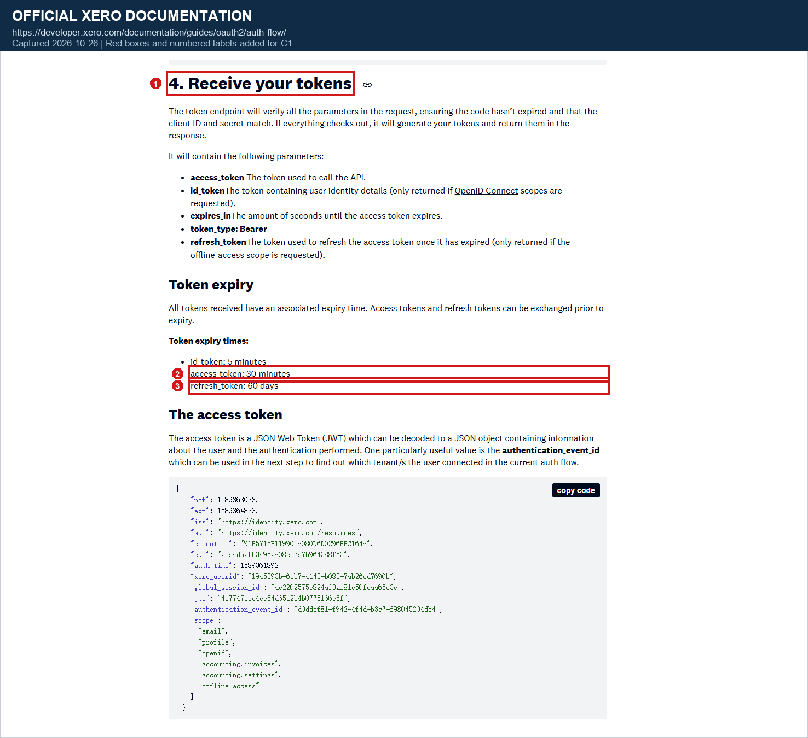

*Screenshot evidence: (1) the response fields after a successful token exchange; (2) the 30-minute access-token lifetime; (3) the 60-day refresh-token lifetime; the JWT example also shows the `accounting.invoices` and `offline_access` scopes.*

Screenshot original: [View original](screenshots/c1-token-expiry.png)

**Why this step**

- This step proves that "the application can obtain a user-authorised token with this client credential and refresh token"; it cannot yet prove that the token can reach the target tenant's invoices.
- Whether the token is valid or expired, and whether `offline_access` has been granted, can be detected before any invoice request is sent, which stops authentication problems from being misdiagnosed as tenant or invoice problems.
- Because a refresh returns a new refresh token, the save must be atomic; otherwise concurrent workers can overwrite each other and the user ends up having to re-authorise.

### Step 2: Verify the tenant connection and tenant ID

- Call `GET https://api.xero.com/connections` with `Authorization: Bearer <access_token>`.
- HTTP 200 proves that Xero accepted the access token; the returned array proves which tenant connections that user can list.
- The exact `tenantId` stored locally must be found, and `tenantType` must be confirmed as `ORGANISATION`; do not select by `tenantName`, and do not treat `connections[].id` as the API tenant ID.
- If this is part of the current authorisation flow, add `authEventId` to the `/connections` request to filter down to the connections just authorised or re-authorised by that flow.

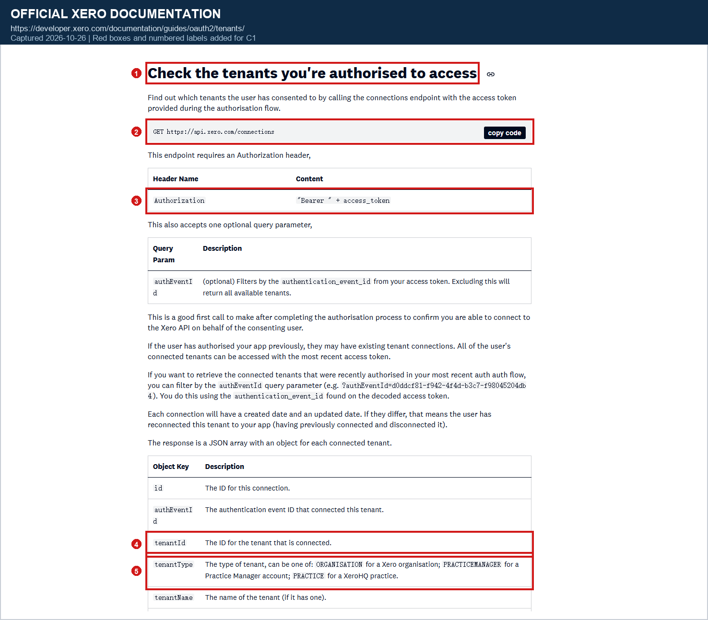

*Screenshot evidence: (1) the documentation requires checking which tenants the user has authorised first; (2) `GET /connections` is the recommended first verification call; (3) the request must use a Bearer token; (4) `tenantId` identifies the target tenant; (5) `tenantType` confirms it is an `ORGANISATION`.*

Screenshot original: [View original](screenshots/c1-connections-endpoint.png)

**Why this step**

- A successful token refresh only proves the token came from the right client; it does not prove the user has connected the target organisation to this application, and `/connections` is the verification point between OAuth and tenant selection.
- If the target `tenantId` is not in the array, the user has not connected that organisation, access has been revoked, permissions have been removed, or the local tenant mapping is stale; continuing to read invoices would only produce a predictable authorisation error.
- This step proves only the token and the tenant selection; it does not prove the invoice scope, nor that the later `Xero-Tenant-Id` request header will be accepted for that tenant.

### Step 3: Verify the final tenant context with the smallest tenant-scoped request

- Every organisation-scoped request must send both `Authorization: Bearer <access_token>` and `Xero-Tenant-Id: <tenantId>`.
- `GET /connections` has no `Xero-Tenant-Id` header, so it cannot serve as the final evidence that "the target tenant header has been accepted".
- If the application already has the relevant settings-read scope, make one minimal `GET /Organisation` call first; if it only has invoice scopes, a first-page probe with `GET /Invoices?page=1&pageSize=1&summaryOnly=true` is enough.
- Once the probe returns 200, the access token, `tenantId`, organisation access, and request routing have been jointly verified in the same context, and only then may the full invoice sync continue.

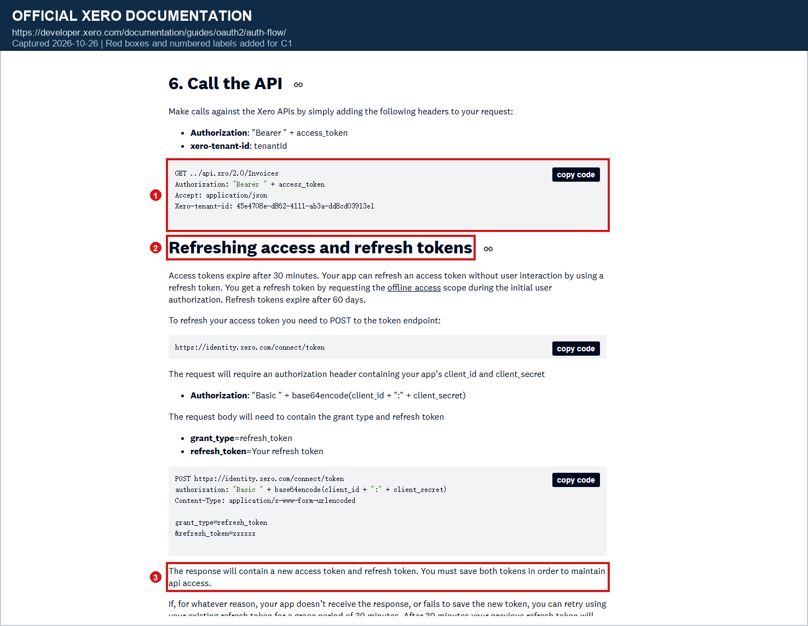

*Screenshot evidence: (1) the official invoice request uses both `Authorization` and `Xero-tenant-id`; (2) a background service renews itself with the refresh token; (3) the refresh response must be accompanied by saving both the new access token and the new refresh token.*

Screenshot original: [View original](screenshots/c1-tenant-header-refresh.png)

**Why this step**

- Xero's invoice endpoints are organisation-scoped APIs; without `Xero-Tenant-Id`, or with the wrong one, the caller cannot prove which organisation it is reading from.
- Declaring "connection verification complete" on the strength of `/connections` alone leaves a gap: a valid token does not mean the request header, the target tenant, and the environment mapping are all correct at the same time.
- Finishing with one minimal request avoids pulling a large amount of data from a large organisation only to discover a tenant-header or permission error afterwards.

### C1 core verification pseudocode

- The input is the local tenant record and the secret store; the output is a minimal context whose token, scopes, tenant, and headers have all been verified.
- Any failed assertion must return an explicit status instead of continuing to read invoices.

```python
def verify_before_invoice_sync(local_tenant) -> TenantContext:
    # Refresh first, then save access_token and refresh_token atomically
    tokens = secret_store.refresh_if_needed(local_tenant)
    assert tokens.access_token is not None
    assert tokens.refresh_token is not None

    scopes = decode_jwt_scopes(tokens.access_token)
    required = {"accounting.invoices.read", "offline_access"}
    assert required <= scopes, "missing required scope"

    connections = xero_get(
        "/connections",
        headers={"Authorization": f"Bearer {tokens.access_token}"},
    )
    assert connections.status == 200

    connection = find_one(
        connections.items,
        where=lambda item: (
            item["tenantId"] == local_tenant.xero_tenant_id
            and item["tenantType"] == "ORGANISATION"
        ),
    )
    assert connection is not None, "tenant not connected or no longer authorised"

    headers = {
        "Authorization": f"Bearer {tokens.access_token}",
        "Xero-Tenant-Id": local_tenant.xero_tenant_id,
    }
    probe = xero_get(
        "/Invoices",
        params={"page": 1, "pageSize": 1, "summaryOnly": "true"},
        headers=headers,
    )
    assert probe.status == 200

    return TenantContext(
        access_token=tokens.access_token,
        tenant_id=local_tenant.xero_tenant_id,
        headers=headers,
    )
```

### Pre-sync acceptance checklist

- `POST /connect/token` succeeds, and the access token and refresh token have been saved atomically.
- The access token's `scope` contains the minimal invoice scope required by the current operation.
- `GET /connections` returns 200 and contains the expected `tenantId` with `tenantType=ORGANISATION`.
- The local environment, tenant record, `tenantId`, and client credentials all come from the same configuration set.
- The first tenant-scoped probe request carries both the Bearer token and the correct `Xero-Tenant-Id`, and returns 200.

## C2 - Failure Diagnosis

The diagnosis order is fixed: confirm the request environment and endpoint path first, record sanitised context second, classify by HTTP status and Xero error code third, and only then decide whether to refresh, retry, pause, or require re-authorisation.

### Response-code classification

- 401 means the authentication credential is invalid, for example the access token is missing, expired, malformed, or has been revoked.
- 403 means the request was authenticated, but the current user, scope, tenant header, or organisation permissions do not allow the operation.
- 404 means the specified resource or route does not exist; check the base URL, API version, and resource ID first rather than treating it as an expired token.
- 412 means a precondition in the request headers was not met; Xero's status-code table also notes that TLS 1.0 may return 412.
- 429 means a tenant-level or application-level rate-limit window has been exhausted; read the response headers and wait instead of resending immediately.
- 500 means Xero hit an unhandled server-side error; automatic retry is allowed only when the action is known to be safely replayable.
- 501 means the called method or capability is not implemented, which is usually a client configuration or endpoint-choice error and should not be blindly retried.
- 503 may mean temporary maintenance, or that the target organisation is temporarily offline; the two cases need different waiting and recovery strategies.

Official source: [Xero HTTP Response Codes & Errors](https://developer.xero.com/documentation/api/accounting/responsecodes)

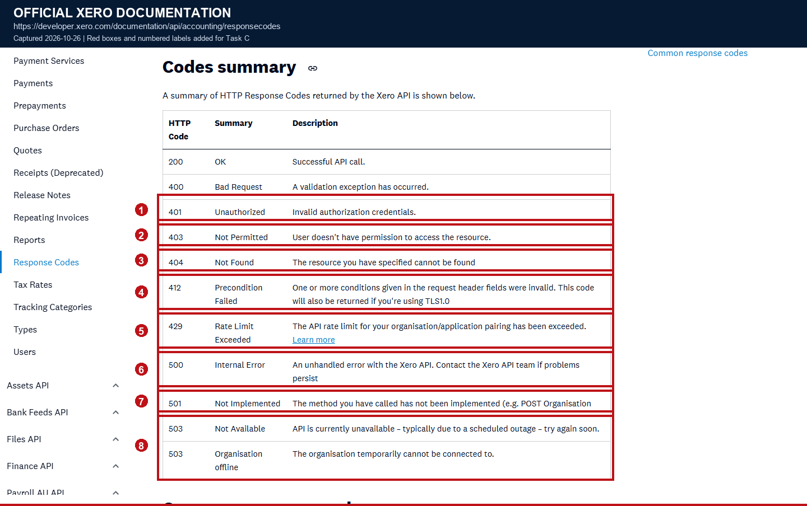

*Screenshot evidence: (1) 401 invalid authentication credentials; (2) 403 insufficient permission; (3) 404 resource does not exist; (4) 412 request-header precondition failed; (5) 429 rate limiting; (6) 500 internal server error; (7) 501 method not implemented; (8) 503 service unavailable or organisation offline.*

Screenshot original: [View original](screenshots/c2-response-codes.png)

**Why this step**

- The status code only gives a classification; what actually decides the action also includes the Xero error code, the response body, whether the request is a write, and the current idempotency state.
- Separating 400, 401, 403, 404, 412, and 501 from retryable errors stops the synchroniser from burning its retry budget on configuration or permission errors.

### HTTP 401 and token refresh

- After a 401, only one exchange of the refresh token for a new access token is allowed, followed by exactly one retry of the original request with its original parameters.
- If the original request is a write, the retry must keep using the original `Idempotency-Key`; a retry must never generate a new key.
- If the refresh returns `invalid_grant`, it usually means the authorisation code or refresh token is wrong, expired, or already used, or that the `grant_type` is incorrect.
- Xero's documentation states that the final resolution for this error is for the user to re-authorise, so the system should pause that tenant and enter a "user action required" state.
- A 401 must never be handled by an unbounded refresh loop; a failed refresh should raise an alert and retain the already-sanitised diagnostic information.

Official source: [Xero OAuth 2.0 Troubleshooting - Invalid grant](https://developer.xero.com/documentation/guides/oauth2/troubleshooting/)

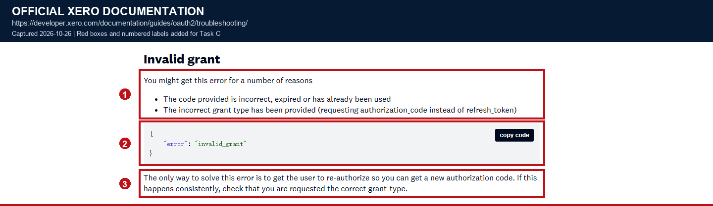

*Screenshot evidence: (1) the authorisation code or grant type may be wrong; (2) the server returns `invalid_grant`; (3) the documentation explicitly requires the user to re-authorise.*

Screenshot original: [View original](screenshots/c2-invalid-grant.png)

**Why this step**

- One refresh rules out an ordinary short-lived access-token expiry, but a failed refresh shows the problem has crossed beyond normal token renewal.
- Keeping the same idempotency key on a write makes it safe to retry after authentication recovers, without producing a duplicate invoice because "the first attempt actually succeeded".

### HTTP 403, tenant authorisation, and scopes

- 403 should not be retried directly; first confirm the token is still valid, then check `Xero-Tenant-Id`, the user's role, the organisation status, and the scope.
- When `detail` is `AuthenticationUnsuccessful`, the documented causes include a missing or wrong tenant header, a user having revoked the connection, a change in user permissions, and an organisation no longer being active.
- At that point `/connections` must be called again to confirm that the stored `tenantId` still exists with `tenantType=ORGANISATION`; never guess by organisation name or `connection.id`.
- Read-only synchronisation should use `accounting.invoices.read`; the wider `accounting.invoices` is needed only to create or update invoices.
- Even with the correct scope, still check the authorised user's role in the Xero organisation, that user's feature permissions, and whether the organisation has been suspended or is offline.

Official source: [Xero OAuth 2.0 Troubleshooting - Authentication unsuccessful](https://developer.xero.com/documentation/guides/oauth2/troubleshooting/)

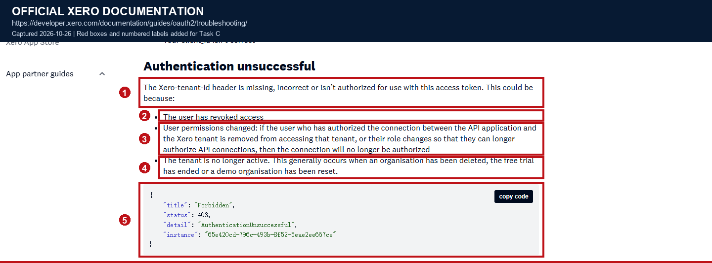

*Screenshot evidence: (1) the tenant header is missing, wrong, or unusable; (2) the user has revoked access; (3) user permissions have changed; (4) the organisation is no longer active; (5) the official 403 `AuthenticationUnsuccessful` response.*

Screenshot original: [View original](screenshots/c2-tenant-auth-errors.png)

Official source: [Xero OAuth 2.0 Scopes](https://developer.xero.com/documentation/guides/oauth2/scopes/)

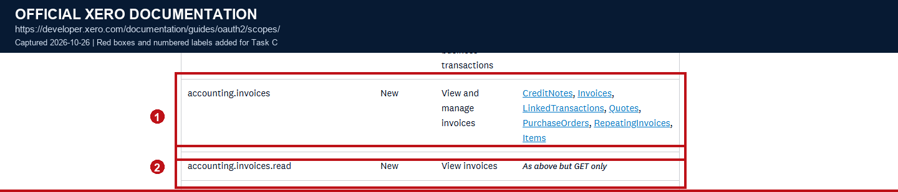

*Screenshot evidence: (1) `accounting.invoices` is for viewing and managing invoices; (2) `accounting.invoices.read` only allows reading invoices.*

Screenshot original: [View original](screenshots/c2-invoice-scopes.png)

Official source: [Xero OAuth 2.0 Troubleshooting - TLS errors](https://developer.xero.com/documentation/guides/oauth2/troubleshooting/)

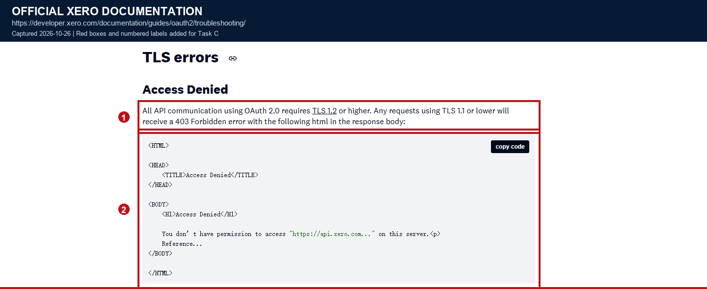

*Screenshot evidence: (1) all OAuth 2.0 API traffic requires at least TLS 1.2; (2) older TLS versions may receive an HTML `Access Denied` response.*

Screenshot original: [View original](screenshots/c2-tls-errors.png)

**Why this step**

- A 403 simultaneously covers tenant mapping, user permissions, scopes, and transport security, so a direct retry only repeats the same failure under the same conditions.
- Only by using the minimal scope to limit over-authorisation and by verifying tenant identity, user permissions, and protocol version separately can you tell which layer actually needs fixing.
- The documentation's example for an older TLS version is an HTML `Access Denied` carried on a 403, while the status-code table also mentions that TLS 1.0 may return 412, so diagnosis must check the status, the response body, the TLS version, and the request path together.

### HTTP 404 and HTTP 412

- When a list endpoint returns 404, check the API host, version, proxy rewrites, path casing, and environment configuration first.
- When a single resource returns 404, check whether the `InvoiceID` belongs to the current tenant, and whether the resource was deleted or never existed.
- A wrong tenant normally surfaces as a 403 tenant-authorisation error, so not every 404 should be blamed on "expired token" or "missing scope".
- For 412, check `If-Modified-Since`, the conditional-header format, and any other preconditions first, and confirm that the call path has not degraded to TLS 1.0.

**Why this step**

- 404 and 412 are mostly problems with a definite fix; automatic retries create useless traffic and mask environment, proxy, or protocol misconfiguration.
- Distinguishing "route does not exist", "resource does not exist", and "precondition failed" first allows an accurate alert and remedy instead of merging all three into one generic retry.

### C2 error-classification pseudocode

- The program classifies by HTTP status and Xero `detail` first, then decides whether to refresh, retry, reconcile, or pause; each call site is not allowed to improvise.
- A write request is retried only when it is known to be safe, and it always reuses the original idempotency key.

```python
def classify_and_handle(request, response):
    detail = response.body.get("detail")

    if response.is_network_timeout:
        return Outcome(
            action="RETRY_OR_RECONCILE",
            reason="RESULT_UNKNOWN",
            retryable=True,
        )

    if response.status == 401:
        if request.refresh_attempted:
            return Outcome("PAUSE_TENANT", "AUTH_REFRESH_FAILED")
        refresh = refresh_token_once(request.tenant)
        if refresh.error == "invalid_grant":
            return Outcome("REQUIRE_REAUTHORISATION", "invalid_grant")
        return Outcome(
            "RETRY_ONCE",
            "REFRESHED_TOKEN",
            idempotency_key=request.idempotency_key,
        )

    if response.status == 403:
        verify_connections(request.tenant)
        if detail == "AuthenticationUnsuccessful":
            return Outcome("RECONNECT_OR_FIX_TENANT", detail)
        return Outcome("FIX_SCOPE_OR_PERMISSION", detail)

    if response.status in {400, 404, 405, 412, 422, 501}:
        return Outcome("NON_RETRYABLE_CONFIG_OR_VALIDATION", detail)

    if response.status == 409:
        return Outcome("RECONCILE_CONFLICT", detail)

    if response.status == 429:
        return Outcome(
            "WAIT_AND_RETRY",
            response.headers["X-Rate-Limit-Problem"],
            wait_seconds=response.headers.get("Retry-After"),
        )

    if response.status == 500:
        return Outcome("RETRY_WITH_BUDGET", "XERO_INTERNAL_ERROR")

    if response.status == 503:
        if detail == "OrganisationOffline":
            return Outcome("RETRY_LATER", detail, wait_seconds=5 * 60)
        return Outcome("RETRY_WITH_BUDGET", "SERVICE_UNAVAILABLE")

    return Outcome("ESCALATE_UNKNOWN_RESPONSE", detail)
```

### C2 acceptance checklist

- Every error log can be tied to the environment, tenant, request path, attempt count, HTTP status, Xero `detail`, and `X-Correlation-Id`.
- A 401 is retried only once, after a single successful refresh, and writes keep the original idempotency key.
- `invalid_grant`, `AuthenticationUnsuccessful`, missing scope, and TLS degradation each have their own handling path.
- 400, 403, 404, 412, and 501 never enter the ordinary exponential-backoff queue.
- 429, 500, temporary 503, and network errors enter a budgeted retryable queue.

## C3 - Incremental Synchronisation

### Cursor model

- Each environment and each `tenantId` stores its own cursor; the recommended fields are `watermark_utc`, `run_id`, the last committed page number, and the last `InvoiceID`.
- At the start of each run, record a `run_started_at` and read from "the old watermark minus the overlap window", for example 5 to 15 minutes back.
- The overlap window covers second-level timestamps, concurrent updates, clock error, and records that move between pages while the sync is running.
- Records must be upserted idempotently on `(tenantId, InvoiceID)`; reading the same record twice must not create duplicate data.

**Why this step**

- Incremental sync is not a point-in-time consistent snapshot; an update made after the first page is read can move a record into a later page.
- Saving the page number and the last business key allows recovery from a defined checkpoint after a failure, instead of starting over or skipping unfinished pages.

### Capability boundaries of If-Modified-Since

- Incremental invoice reads use the `If-Modified-Since` HTTP header, with a UTC value precise to the second.
- The header is a "lower-bound start-time filter", not a snapshot with a fixed end time, and it is not a substitute for pagination.
- Xero explicitly warns that not every change updates `UpdatedDateUTC`, for example some payment-related fields, `DueDate`, `SentToContact`, and contact fields derived from other sources.
- `If-Modified-Since` therefore cannot be treated as an absolutely complete change log; key fields need periodic longer-window or full reconciliation.

Official source: [Xero HTTP Requests and Responses - Retrieving modified resources](https://developer.xero.com/documentation/api/accounting/requests-and-responses)

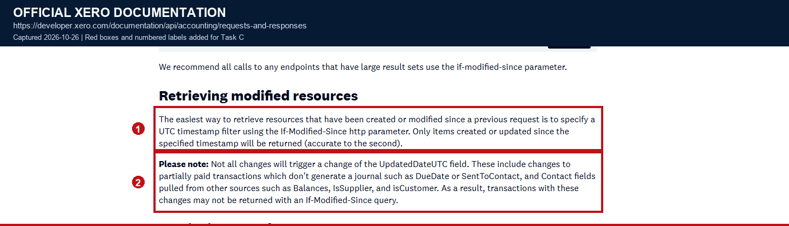

*Screenshot evidence: (1) `If-Modified-Since` returns only records created or updated after the given time; (2) the documentation explicitly lists the fields and scenarios where `UpdatedDateUTC` may not be updated.*

Screenshot original: [View original](screenshots/c3-modified-since-limitations.png)

**Why this step**

- If the system treats incremental filtering as a complete source of truth, missed `DueDate` or payment-related changes will pollute the local state for a long time.
- Using an overlap window to reduce the chance of missed reads, and then covering the documented blind spots with periodic reconciliation, is more reliable than shortening the polling interval without bound.

### Pagination and checkpoints

- Every run uses a fixed `page=1` and a fixed `pageSize`; the documented default is 100, the minimum is 1, and the maximum is 1000.
- If the requested value is out of range, Xero silently adjusts it to the nearest supported value, so the client must still validate and record the effective page size.
- The `pagination` object in the response contains `page`, `pageSize`, `pageCount`, and `itemCount`.
- Stop when `page >= pageCount` or when an empty page is returned; do not rely only on "the current page has fewer than pageSize records".
- Each page's records, the page number, and the last business key must be committed in the same database transaction, and only then may that checkpoint be acknowledged.
- A failed page must not advance the global watermark; replay from the last successfully committed page, or the page before it.

Official source: [Xero HTTP Requests and Responses - Retrieving paged resources](https://developer.xero.com/documentation/api/accounting/requests-and-responses)

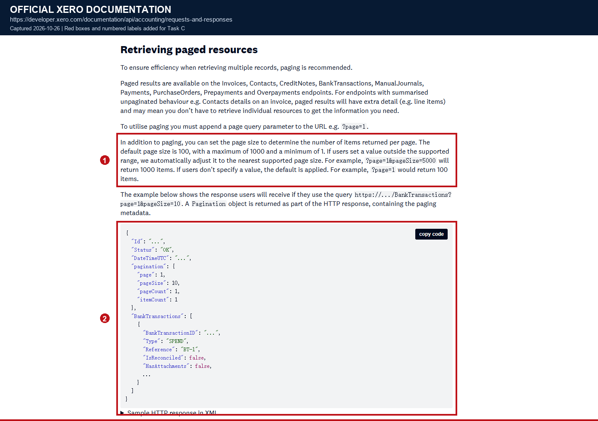

*Screenshot evidence: (1) default page size 100, maximum 1000, minimum 1; (2) the response contains `page`, `pageSize`, `pageCount`, and `itemCount`.*

Screenshot original: [View original](screenshots/c3-pagination.png)

**Why this step**

- A fixed page size makes page boundaries reproducible, and a transactional checkpoint ensures that "the database has been written" and "the cursor has advanced" never half-succeed.
- Using the server's `pageCount` instead of guessing whether another page exists correctly handles cases where the record count is an exact multiple of the page size.

### Stable ordering and business keys

- The default invoice query order is `UpdatedDateUTC ASC, InvoiceId ASC`; the second sort key keeps records with identical update times stable across pages.
- If an explicit sort is needed, use only the documented optimised fields and supply a stable secondary key equivalent to the default order.
- `InvoiceID` is the Xero-generated invoice identifier and is unique within an organisation, so the cross-tenant business key is `(tenantId, InvoiceID)`.
- `InvoiceNumber` is unique for `ACCREC` sales invoices, but is not required to be unique for `ACCPAY` bills.
- `Reference` is only an additional reference number; it cannot serve as a unique identity or as the sole basis for automatic reconciliation.

Official source: [Xero Invoices - Optimised ordering](https://developer.xero.com/documentation/api/accounting/invoices/)

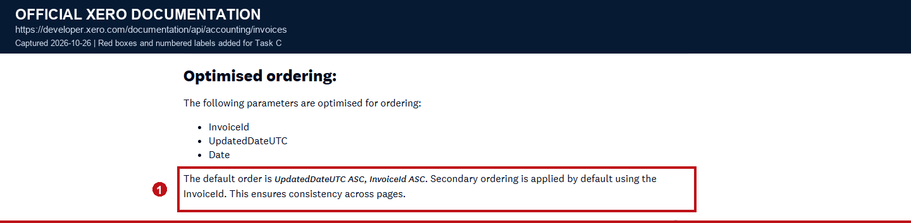

*Screenshot evidence: (1) the default order is `UpdatedDateUTC ASC, InvoiceId ASC`, and the documentation explains that the secondary sort keeps paging consistent.*

Screenshot original: [View original](screenshots/c3-invoice-ordering.png)

Official source: [Xero Invoices - Invoice fields](https://developer.xero.com/documentation/api/accounting/invoices/)

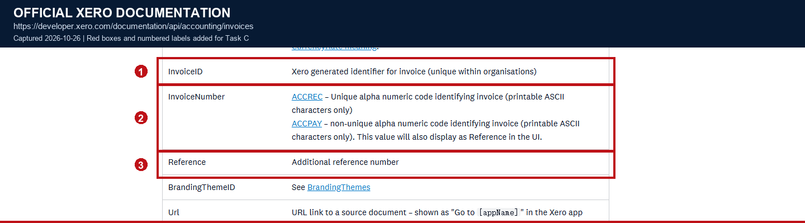

*Screenshot evidence: (1) `InvoiceID` is unique within an organisation; (2) `InvoiceNumber` is unique for ACCREC but not for ACCPAY; (3) `Reference` is only an additional reference number.*

Screenshot original: [View original](screenshots/c3-invoice-identifiers.png)

**Why this step**

- If new records are inserted or already-read records change during pagination, only stable ordering plus an idempotency key prevents missed reads and duplicate writes.
- Bill numbers may repeat, so treating `InvoiceNumber` as a global unique key would produce overwrites or incorrect merges on real organisation data.

### Watermark advancement, recovery, and reconciliation

- Only after all pages succeed, the necessary reconciliation is complete, and everything has been committed may the watermark advance to the `run_started_at` recorded before the run started.
- Do not simply set the watermark to the latest `UpdatedDateUTC` observed in this run; that would skip changes created during the sync but never seen, or changes that happen afterwards.
- On partial failure, keep the old watermark; all duplicate records are absorbed by the `(tenantId, InvoiceID)` upsert.
- On update, compare `UpdatedDateUTC` so that an older response cannot overwrite a newer version; statuses such as `DELETED` and `VOIDED` are also persisted as ordinary updates.
- A single invoice query returning more than 100,000 records triggers the high-volume threshold and may return 400, so split the time window, paginate, and use optimised filter fields.
- Webhooks are only a hint to "re-read this invoice as soon as possible"; they are not the sole source of truth, and periodic full or longer-window reconciliation is still required.

**Why this step**

- New writes still happen while the sync runs, so using this run's maximum value directly leaves a hole in the time window that can never be covered again.
- Old watermark plus overlap window is the recoverable conservative choice; database idempotency and version comparison absorb duplicates and out-of-order arrivals.
- Periodic reconciliation covers Xero's documented `UpdatedDateUTC` blind spots, and also covers lost, delayed, or duplicated webhooks.

### C3 incremental-sync pseudocode

- Each run fixes `run_started_at` first and reads from the old watermark minus the overlap window.
- Each page's records and checkpoint are committed in the same transaction; only after everything succeeds does the watermark advance to this run's start time.

```python
def sync_invoices(tenant):
    run_started_at = utc_now()
    query_from = tenant.watermark_utc - OVERLAP_WINDOW
    page = 1
    page_size = 500
    last_invoice_id = None

    while True:
        response = xero_get(
            "/Invoices",
            headers={
                **tenant.auth_headers,
                "If-Modified-Since": to_utc_seconds(query_from),
            },
            params={
                "page": page,
                "pageSize": page_size,
                "order": "UpdatedDateUTC ASC, InvoiceId ASC",
            },
        )
        assert response.status == 200

        pagination = response.body["pagination"]
        page_count = pagination["pageCount"]

        with database.transaction():
            for invoice in response.body["Invoices"]:
                upsert_if_newer(
                    key=(tenant.xero_tenant_id, invoice["InvoiceID"]),
                    value=invoice,
                    compare_field="UpdatedDateUTC",
                )
                last_invoice_id = invoice["InvoiceId"]
            save_checkpoint(
                tenant=tenant,
                run_started_at=run_started_at,
                page=page,
                last_invoice_id=last_invoice_id,
            )

        if page >= page_count or not response.body["Invoices"]:
            break
        page += 1

    with database.transaction():
        tenant.watermark_utc = run_started_at
        save(tenant)

    schedule_periodic_reconciliation(tenant)
```

### C3 acceptance checklist

- Cursors are isolated per environment and per tenant, and record this run's start time, page number, and last business key.
- `If-Modified-Since` uses an overlap window, and `UpdatedDateUTC` is not treated as an absolutely complete change log.
- Page size is pinned between 1 and 1000, and pagination ends on `pageCount` or an empty page.
- Each page's data and checkpoint are committed in the same transaction, and a failure never advances the global watermark.
- Writes use `(tenantId, InvoiceID)` and use `UpdatedDateUTC` to prevent old data from overwriting new data.
- Periodic full or long-window reconciliation exists and can cope with the 100,000-record high-volume threshold.

## C4 - Rate Limits

### Layered quota model

- Each tenant currently allows at most 5 concurrent requests.
- Each tenant allows 60 requests per minute.
- The daily allowance is 1,000 requests on Starter and 5,000 requests on higher tiers.
- The whole application allows at most 10,000 requests per minute across all tenants.
- Every response includes `X-DayLimit-Remaining`, `X-MinLimit-Remaining`, and `X-AppMinLimit-Remaining`.
- The scheduler should combine "a semaphore of at most 5 in-flight requests per tenant + a per-minute token bucket + an application-level global token bucket".
- Large historical syncs should run off-peak and use a tenant-fair queue so that one organisation cannot consume the whole global capacity.

Official source: [Xero OAuth 2.0 API limits](https://developer.xero.com/documentation/guides/oauth2/limits/)

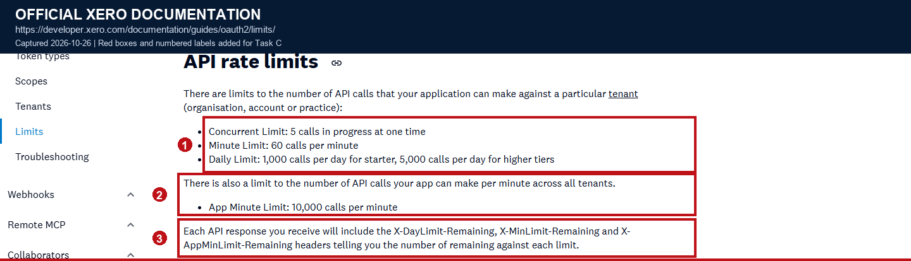

*Screenshot evidence: (1) per-tenant concurrency, minute, and daily allowances; (2) the cross-tenant application allowance per minute; (3) the three remaining-allowance response headers.*

Screenshot original: [View original](screenshots/c4-rate-limits.png)

**Why this step**

- Limiting only requests per minute does not prevent exceeding the concurrency limit, and limiting only concurrency does not control the total call volume within a minute.
- The cross-tenant application allowance is a shared resource; without a global token bucket, several active tenants can drain the whole application's per-minute allowance at the same time.
- Reading the remaining-allowance headers turns scheduling from "fail first, then retry" into "reduce the send rate in advance".

### HTTP 429 and Retry-After

- A 429 response includes `X-Rate-Limit-Problem`, which identifies which kind of limit was hit.
- Minute or daily limits also provide `Retry-After`, the minimum number of seconds to wait before requesting again.
- Limits use fixed windows, and different tenants' windows reset at different times, so do not assume every tenant recovers on a whole-minute boundary.
- On a tenant-level 429, pause that tenant's queue; on an application-level 429, pause new requests for all tenants.
- Add a small random jitter to the `Retry-After` wait so that many workers resuming at once do not create another spike.

Official source: [Xero OAuth 2.0 API limits - Exceeding a rate limit](https://developer.xero.com/documentation/guides/oauth2/limits/)

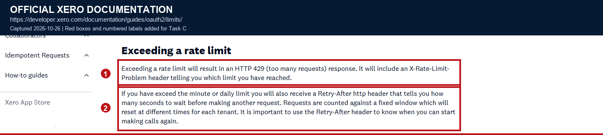

*Screenshot evidence: (1) the 429 includes `X-Rate-Limit-Problem`; (2) minute or daily limits provide `Retry-After`, and the documentation notes that tenants' fixed windows reset at different times.*

Screenshot original: [View original](screenshots/c4-429-retry-after.png)

**Why this step**

- Without reading `X-Rate-Limit-Problem` you cannot tell whether to pause a single tenant or the whole application, which can cause a wrong global stop or continued limit collisions.
- Not waiting for `Retry-After` wastes requests, increases queue latency, and can drain `X-DayLimit-Remaining` faster.

### Retryable and non-retryable errors

- Network connection failures, timeouts, 429, 500, and temporary 503 can enter the retryable queue.
- A 503 for an offline organisation may be retried after about 5 minutes, as Xero recommends, with a longer maximum wait ceiling.
- 400, 403, 404, 405, 412, 422, and 501 should not be blindly retried.
- A 401 may be retried only after one successful refresh; a failed refresh should pause the tenant.
- A 409 should be resolved by reading or querying the current resource first; never force a retry by overwriting.
- If a 400 is caused by a query returning more than 100,000 records, narrow the time window, paginate, and optimise the filters instead of sending the same request again.
- When the server gives no wait hint, use exponential backoff with full jitter, and set a retry budget per task, tenant, and time window.
- A write request may be retried automatically only when it carries the same `Idempotency-Key` or when a verifiable query-reconciliation mechanism exists.

Official source: [Xero HTTP Response Codes & Errors](https://developer.xero.com/documentation/api/accounting/responsecodes)

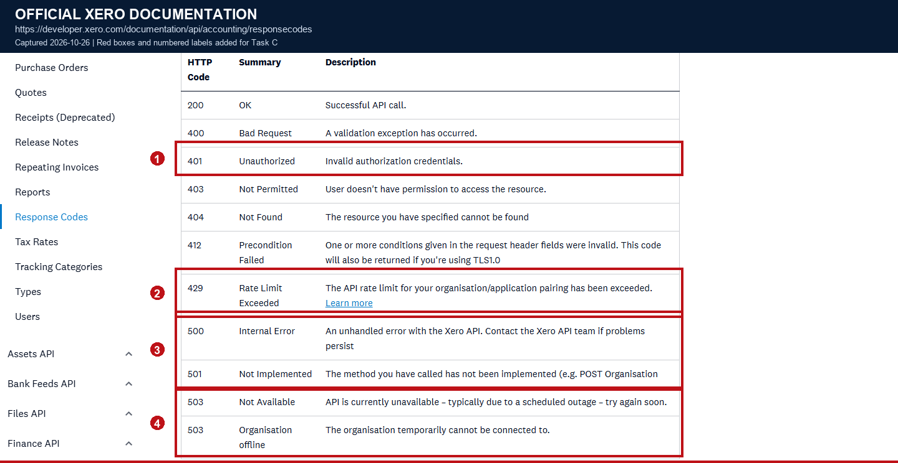

*Screenshot evidence: (1) 401 requires authentication to be restored first; (2) 429 is rate limiting; (3) 500/501 need to distinguish a temporary service error from an unimplemented capability; (4) 503 covers both temporary unavailability and an offline organisation.*

Screenshot original: [View original](screenshots/c4-retryable-response-codes.png)

Official source: [Xero Idempotent requests - Rate limiting](https://developer.xero.com/documentation/guides/idempotent-requests/idempotency/)

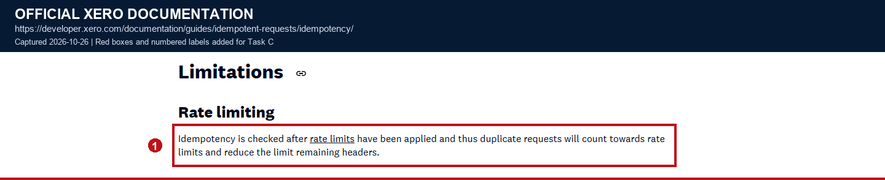

*Screenshot evidence: (1) the idempotency check happens after rate limiting, so duplicate requests still consume allowance and reduce the remaining-allowance headers.*

Screenshot original: [View original](screenshots/c4-idempotency-rate-limit.png)

**Why this step**

- Retries only add value for transient faults; putting parameter, permission, routing, or protocol errors into the retry queue only amplifies the failure.
- Idempotency prevents duplicate business results but cannot stop duplicate requests from consuming rate-limit allowance, so a retry budget and idempotency must both exist.
- When a write's outcome is unclear, the right move is query reconciliation, not automatically deleting, voiding, or issuing a second create request.

### C4 scheduling-and-retry pseudocode

- A tenant queue acquires the concurrency and minute tokens first, then the application-level minute token; if any layer has no capacity, the job goes to the delayed queue.
- After a 429, prefer the server's `Retry-After`; use exponential backoff with full jitter only when it is absent.

```python
def execute_with_limits(tenant, job, attempt):
    if not app_limiter.try_acquire_minute_slot():
        return park_until(app_limiter.next_minute_window())

    if not tenant_limiter.try_acquire_minute_slot(tenant):
        return park_until(tenant_limiter.next_minute_window(tenant))

    with tenant_limiter.semaphore(tenant, limit=5):
        response = send(job.request)
        update_quota_metrics(response.headers)

    if response.status == 429:
        problem = response.headers["X-Rate-Limit-Problem"]
        retry_after = response.headers.get("Retry-After")
        wait_seconds = retry_after or full_jitter(attempt)
        pause_scope(problem, tenant, wait_seconds)
        return Outcome("RETRY_LATER", problem, wait_seconds)

    if is_transient(response):
        if attempt >= MAX_ATTEMPTS:
            return Outcome("PARK_AND_ALERT", "RETRY_BUDGET_EXHAUSTED")
        return Outcome("RETRY_WITH_BACKOFF", full_jitter(attempt))

    return classify_and_handle(job.request, response)


def send_for_write_with_idempotency(job):
    assert job.intent.idempotency_key is not None
    assert job.request.body_hash == job.intent.body_hash
    return send(job.request)
```

### C4 acceptance checklist

- At most 5 concurrent requests per tenant, with observable queue waiting time.
- The scheduler enforces all three layers at once: 60/minute per tenant, the daily allowance, and 10,000/minute per application.
- A 429 pauses exactly the right layer, based on `X-Rate-Limit-Problem` and `Retry-After`.
- Every error has an explicit classification: retryable, retry-after-refresh, or manual handling.
- Write retries reuse the same idempotency key, and an unclear outcome triggers query reconciliation.
- When the retry budget is exhausted the task moves to a delayed queue and raises an alert, never into unbounded retries.

## C5 - Data Integrity

### Transactional outbox and immutable invoice intent

- The `POST` request that creates an invoice must carry an `Idempotency-Key`.
- Xero applies idempotency keys only to `POST`, `PUT`, and `PATCH` requests that modify data; other methods ignore the header.
- A later request with the same key returns the cached response and does not execute the create logic again.
- Before the first send, the system must persist the idempotency key in the database, bound to the internal order intent, the HTTP method, the fixed URL, and the request-body hash.
- Once sending has started, the request body must not be modified in place; any field change must produce a new invoice intent and a new idempotency key.
- The order event and the single invoice-intent record should be written in the same database transaction, and the worker claims only intents that have already been committed.

Official source: [Xero Idempotent requests - How it Works](https://developer.xero.com/documentation/guides/idempotent-requests/idempotency/)

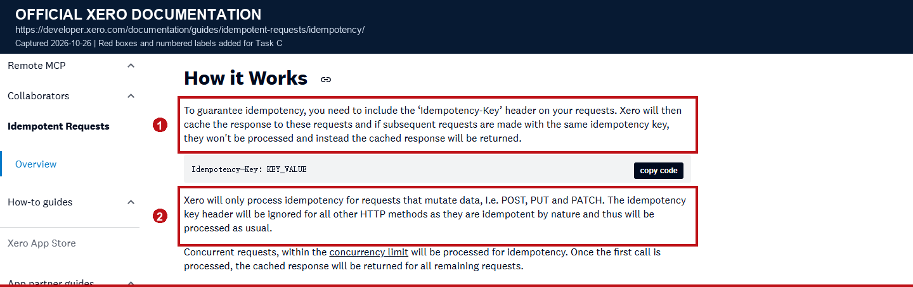

*Screenshot evidence: (1) the request uses `Idempotency-Key` and receives a cached response; (2) Xero applies idempotency keys only to POST, PUT, and PATCH.*

Screenshot original: [View original](screenshots/c5-idempotency-key.png)

**Why this step**

- If the key lives only in memory or is saved after sending, a process crash leaves the recovering worker unable to know which key to reuse.
- A fixed request-body hash prevents the same key from being used for different content, and makes an unexpected modification of the order intent visible.
- A transactional outbox avoids the dual-write inconsistency of "the local order is committed but the invoice job is lost" or "the job is created but the order rolls back".

### Idempotency cache, concurrency, and conflicts

- Among concurrent requests, the first one executes, and the others using the same key receive the cached response within the concurrency limit.
- Xero caches an idempotent response for 6 minutes from the first call; after 6 minutes the same key is treated as a new key.
- The same key combined with a different HTTP method, URL, or request body returns 400, because the key is already bound to another request.
- An idempotency key may be at most 128 characters, and a longer one returns 400; Xero does not verify uniqueness on the caller's behalf.
- Duplicate requests still count toward rate limits, so a long-failing task cannot "get lucky" by resending at high frequency.
- The application must enforce "at most one valid create intent per internal order" with a database unique constraint, rather than relying only on Xero's 6-minute cache.

Official source: [Xero Idempotent requests - How it Works](https://developer.xero.com/documentation/guides/idempotent-requests/idempotency/)


*Screenshot evidence: (1) concurrent requests with the same key return the cached response of the first call; (2) the same key with a different request fails, and the cache lifetime is 6 minutes.*

Screenshot original: [View original](screenshots/c5-idempotency-cache-conflicts.png)

**Why this step**

- Xero's cache is only a short-term deduplication layer; the application database is the long-term consistency boundary across restarts, failures, and overnight jobs.
- If one order were allowed to generate several keys, no downstream cache could prevent a duplicate invoice.

### Idempotency errors, failure modes, and the state machine

- The recommended state machine is `PENDING -> SENDING -> SUCCEEDED | RETRYABLE | UNKNOWN -> RECONCILIATION_REQUIRED`.
- A network timeout or dropped connection only means the outcome is "unknown"; it must not be marked as failed directly.
- Within the 6-minute cache window, retry with the same key, because Xero may return the cached response of the first success or failure.
- If Xero keeps returning 500 because its idempotency handling itself is failing, stop retrying blindly and switch to a query that verifies whether the target resource exists.
- Reusing one key for different requests, or a key longer than 128 characters, returns 400; treat it as a program defect, alert, and fix it.

Official source: [Xero Idempotent requests - Error Handling](https://developer.xero.com/documentation/guides/idempotent-requests/idempotency/)

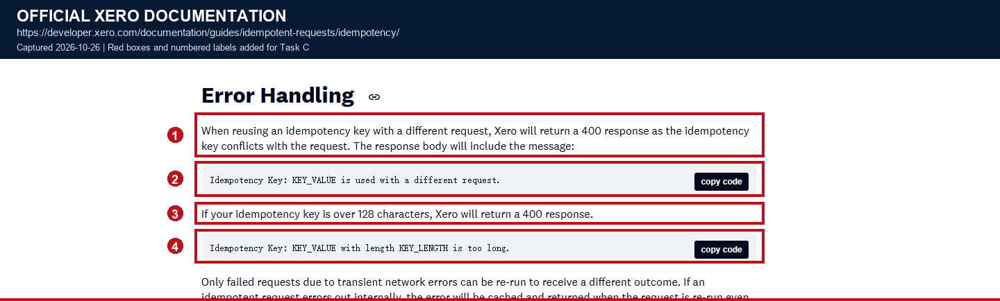

*Screenshot evidence: (1) the same key with a different request returns 400; (2) the official error message; (3) a key longer than 128 characters returns 400; (4) the overlong-key error message.*

Screenshot original: [View original](screenshots/c5-idempotency-errors.png)

Official source: [Xero Idempotent requests - Limitations](https://developer.xero.com/documentation/guides/idempotent-requests/idempotency/)

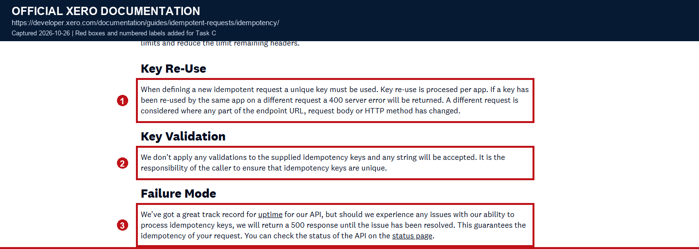

*Screenshot evidence: (1) the same key used with a different URL, request body, or method returns 400; (2) the caller must guarantee uniqueness itself; (3) when idempotency handling fails, Xero keeps returning 500.*

Screenshot original: [View original](screenshots/c5-idempotency-state.png)

**Why this step**

- Treating a timeout as a failure directly produces two serious outcomes: a duplicate invoice, or abandoning an invoice that was actually created.
- The 6-minute cache cannot cover a long outage, so the state machine, the database unique constraint, and query reconciliation must carry long-term recovery.
- A 500 means the server temporarily cannot guarantee idempotency; it does not prove the create failed, and generating a new key could bypass the uniqueness protection.

### Create-response validation

- A write must not be judged successful merely because "no exception was raised".
- Check that the HTTP status is 200 and that the business response has `Status` = `OK`.
- The identifier of the target resource must be obtained, for example the new invoice's `InvoiceID`; a response without an identifier must not move to `SUCCEEDED`.
- Only after the response is complete and the resource identifier has been persisted may the invoice intent be marked successful.
- If HTTP is 200 but the body is incomplete, cannot be parsed, or lacks an `InvoiceID`, move to `UNKNOWN` and run query reconciliation.

Official source: [Xero HTTP Requests and Responses - Creating resources](https://developer.xero.com/documentation/api/accounting/requests-and-responses)


*Screenshot evidence: (1) you must check HTTP 200 and `Status=OK`, and confirm that the response contains the new object's identifier, such as `InvoiceID`.*

Screenshot original: [View original](screenshots/c5-create-response-check.png)

**Why this step**

- Some proxies, SDKs, or error-wrapping layers can return HTTP 200 while the business response still contains a failure status or an incomplete object.
- `InvoiceID` is the stable identity for later queries, updates, and reconciliation; without saving it you cannot prove which invoice corresponds to the internal order.

### Query reconciliation and identity rules

- When the outcome is unclear, prefer a query by the known `InvoiceID`; finding that resource proves the first request already succeeded.
- If no `InvoiceID` was received, query by `InvoiceNumber` only when the integration contract explicitly guarantees that this invoice type's number is unique.
- `InvoiceNumber` is not unique for `ACCPAY`, and `Reference` is only an additional reference number, so neither can be used to assert "it already exists".
- When exactly one candidate is found, save its `InvoiceID` and mark the intent successful.
- Only after confirming the resource does not exist may a new key be generated and the invoice created again, recording why and when the old key was abandoned.
- If there are multiple candidates, field conflicts, manual edits, or ownership cannot be determined, mark `RECONCILIATION_REQUIRED` and raise an alert.
- Never automatically delete or void a financial record to "fix" duplicate candidates; a person with business permission must confirm.

**Why this step**

- An incorrect deletion or void of financial data is more dangerous than keeping an ambiguity that awaits human confirmation, and the deletion itself would need an audit trail.
- Reconciliation must rely on a unique identity; guessing by number or reference would merge two legitimate but similar invoices into one.

### C5 idempotent-create pseudocode

- The idempotency key and the immutable request intent are persisted before sending; after a timeout the intent is marked `UNKNOWN` first, then recovered with the same key or by querying.
- `SUCCEEDED` is reached only when HTTP 200, the business status `OK`, and an `InvoiceID` all hold at the same time.

```python
def create_invoice_idempotently(order):
    intent = database.get_or_create_invoice_intent(order.id)
    if intent.state == "SUCCEEDED":
        return intent.invoice_id

    if intent.state in {"UNKNOWN", "RECONCILIATION_REQUIRED"}:
        return reconcile_invoice(intent)

    if intent.idempotency_key is None:
        body = canonical_json(order.invoice_payload)
        intent.request_body_hash = sha256(body)
        intent.idempotency_key = new_key(prefix=f"invoice-{order.id}")
        assert len(intent.idempotency_key) <= 128
        database.save(intent)

    intent.state = "SENDING"
    database.commit()

    try:
        response = xero_post(
            "/Invoices",
            headers={
                **intent.tenant.auth_headers,
                "Idempotency-Key": intent.idempotency_key,
            },
            body=intent.invoice_payload,
        )
    except NetworkTimeout:
        intent.state = "UNKNOWN"
        database.commit()
        return reconcile_invoice(intent)

    if response.status == 200 and response.body.get("Status") == "OK":
        invoice_id = response.body["Invoices"][0].get("InvoiceID")
        if invoice_id:
            intent.state = "SUCCEEDED"
            intent.invoice_id = invoice_id
            database.commit()
            return invoice_id

    intent.state = "RECONCILIATION_REQUIRED"
    intent.last_response = sanitised_summary(response)
    database.commit()
    return reconcile_invoice(intent)


def reconcile_invoice(intent):
    if intent.invoice_id:
        invoice = xero_get_invoice(
            intent.tenant,
            intent.invoice_id,
            optional=True,
        )
        if invoice:
            intent.state = "SUCCEEDED"
            database.commit()
            return invoice["InvoiceID"]

    candidates = query_candidates_by_guaranteed_identity(intent)
    if len(candidates) == 1:
        intent.state = "SUCCEEDED"
        intent.invoice_id = candidates[0]["InvoiceID"]
        database.commit()
        return intent.invoice_id

    intent.state = "RECONCILIATION_REQUIRED"
    database.commit()
    raise ManualReconciliationRequired(intent.id)
```

### C5 acceptance checklist

- Each internal order has at most one valid invoice intent, backed by a database unique constraint.
- The idempotency key is persisted before sending, is at most 128 characters, and is bound to a fixed method, URL, body hash, and tenant.
- A timeout moves the intent to `UNKNOWN` and never turns directly into a failure or a new key.
- A create response must satisfy HTTP 200, `Status=OK`, and a returned `InvoiceID` at the same time.
- Ambiguous results are reconciled using `InvoiceID`, or a `InvoiceNumber` whose uniqueness the contract guarantees.
- Multiple candidates and manual edits go to manual reconciliation; the system never automatically deletes, voids, or recreates invoices.

## C6 - Observability and Security

### Structured logs and correlation identifiers

- Every log line should include `trace_id`, `job_id`, `run_id`, the internal tenant record ID, the Xero `tenantId`, the invoice intent ID, the endpoint path, the HTTP method, the attempt count, the status code, and the latency.
- Synchronisation logs should also record cursor advancement, page count, retry reasons, 429 allowance, idempotency state transitions, conflicts, and reconciliation results.
- Xero returns `X-Correlation-Id` on every API response; store that value and quote it in support tickets.
- Logs must never contain access tokens, refresh tokens, authorisation codes, client secrets, full `Authorization` headers, bank details, or full financial request bodies.
- Structurally redact customer names, email addresses, addresses, amount line items, and error-response bodies, keeping only the fields needed for diagnosis.

Official source: [Xero OAuth 2.0 Troubleshooting - API headers](https://developer.xero.com/documentation/guides/oauth2/troubleshooting/)

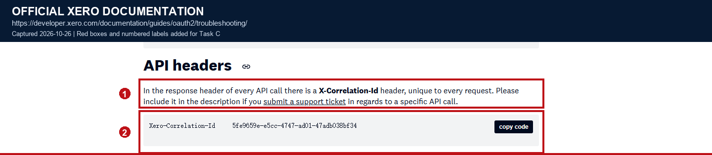

*Screenshot evidence: (1) every API call includes a unique `X-Correlation-Id`; (2) the documentation asks you to provide that value when raising a support ticket.*

Screenshot original: [View original](screenshots/c6-correlation-id.png)

**Why this step**

- Only when the internal trace, the business job, and the Xero correlation ID map onto each other can you quickly prove which Xero-side call a failed request corresponds to.
- Once a financial system writes sensitive fields into ordinary logs, deletion and audit become expensive, so redaction must happen where the log is produced, not in a later batch job.

### Metrics

- Request metrics are broken down by tenant, endpoint, and status code, covering request volume, success rate, latency, 401, 403, 404, 429, and 5xx.
- Quota metrics include `X-DayLimit-Remaining`, `X-MinLimit-Remaining`, `X-AppMinLimit-Remaining`, and concurrency waiting time.
- Job metrics include queue time, page count, invoices processed, last successful sync time, sync lag, and cursor age.
- Data-integrity metrics include retry counts, idempotency conflicts, ambiguous outcomes, the reconciliation backlog, and candidate counts.
- Do not use full `InvoiceID`s, customer IDs, order IDs, or raw URLs as metric labels, to avoid uncontrolled high cardinality.
- Detailed resource IDs belong in structured logs or distributed traces; metrics keep only aggregatable low-cardinality fields.

Official source: [Xero OAuth 2.0 API limits](https://developer.xero.com/documentation/guides/oauth2/limits/)


*Screenshot evidence: (1) every response returns the daily, tenant-minute, and application-minute remaining-allowance headers.*

Screenshot original: [View original](screenshots/c4-rate-limits.png)

Official source: [Xero Idempotent requests - Limitations](https://developer.xero.com/documentation/guides/idempotent-requests/idempotency/)


*Screenshot evidence: (1) Xero keeps returning 500 when idempotency handling fails, so consecutive 500s, idempotency conflicts, and a reconciliation backlog can all be monitored.*

Screenshot original: [View original](screenshots/c5-idempotency-state.png)

**Why this step**

- Error counts alone cannot distinguish "a few tenants failing continuously" from "a global rate limit"; breaking them down by tenant, endpoint, and status is what locates the blast radius.
- Cursor age and sync lag reveal silent failures where "nothing is reporting an error but the data has stopped updating".
- Using IDs as metric labels explodes the number of time series and actually makes the monitoring system less stable.

### Alerts

- Refresh-token failure, `invalid_grant`, repeated 401, or repeated 403 should alert.
- A stored tenant disappearing from `/connections`, a changed `tenantType`, or an organisation being offline for a long time should alert.
- The daily allowance dropping below a safe threshold, 429s persisting, the application's remaining allowance falling fast, or a concurrency queue waiting for a long time should alert.
- An exhausted retry budget, repeated failure of the same page, or a sync cursor older than the freshness target should alert.
- Multiple candidates, idempotency conflicts, a reconciliation backlog above threshold, or a single invoice stuck in `UNKNOWN` for a long time should alert immediately.
- An alert should include the environment, tenant, job type, error class, and correlation ID; it must not include tokens or full financial data.

**Why this step**

- Authentication and tenant-connection problems usually cannot self-heal; the sooner the user is told to re-authorise, the shorter the data outage.
- A reconciliation backlog and a long-lived `UNKNOWN` mean financial data may be duplicated or missing and needs human intervention, not silent retries.

### Client secret, tokens, and transport security

Store each credential according to its scope, lifetime, and access pattern:

| Credential | Storage location | Access rule |
|------|----------|------|
| `Client Secret` | KMS / secrets manager (for example AWS Secrets Manager or Vault) | The application configuration contains only a versioned secret reference; never store the value in the database, source code, environment dump, logs, or frontend |
| Access token | Redis cache at `tenant:{id}:access_token`, plus an encrypted durable copy in the tenant record | TTL is `expires_in` minus a safety margin; Redis is the fast path, while the encrypted database copy supports process restart and cold cache |
| Refresh token | Tenant database record encrypted with a KMS data key (envelope encryption) | Store ciphertext only; decrypt in worker memory immediately before use and discard it after the request |
| Sync cursor / tenant ID | Database plaintext | These values are operational identifiers, not credentials |

**Required tenant token record**

- `encrypted_access_token`, `encrypted_refresh_token`, and `kms_key_version`.
- `access_token_expires_at`, `refresh_token_expires_at`, and `last_rotated_at`.
- `token_version`, incremented by an atomic compare-and-set on every token replacement.
- `connection_state`, using explicit values such as `CONNECTED`, `REFRESHING`, `REAUTHORISATION_REQUIRED`, `DISCONNECTED`, and `QUARANTINED`.
- Encryption context / additional authenticated data binds the environment, application ID, and internal tenant record ID. A copied ciphertext therefore cannot be replayed against another tenant.

**Refresh and rotation rules**

1. Acquire a short-lived lease for the tenant before refreshing. The lease must use a timeout and owner/fencing token so a crashed worker cannot leave the tenant locked indefinitely.
2. Re-read the encrypted tenant record after acquiring the lease. If `token_version` changed, use the latest token instead of the stale value loaded before the lock.
3. Call `POST https://identity.xero.com/connect/token` and treat `access_token`, `refresh_token`, and `expires_in` as required response fields.
4. In one database transaction, update both encrypted tokens, both expiry times, the KMS key version, `last_rotated_at`, and `token_version`, using the previous version as the compare-and-set value.
5. Publish the new access token to Redis only after the transaction commits. Never update the in-memory/Redis value while the database still contains the old token version.

- If Xero returns a successful response but the database commit fails, keep the old database record and old Redis value unchanged. Retry the persistence/refresh flow within Xero's 30-minute recovery window; if the final state is uncertain after that window, mark the tenant for re-authorisation rather than guessing which token is current.
- If the response is missing a new refresh token, reject the whole response and preserve the old token; do not save only the access token.
- If refresh returns `invalid_grant`, set `REAUTHORISATION_REQUIRED` only when the compare-and-set still matches `token_version`. If a newer token version already exists, discard the stale result and retry with the latest tokens.
- If KMS is unavailable or token decryption fails, fail closed, apply bounded retry/backoff, and alert. Never fall back to plaintext storage or a hard-coded key.
- Set the Redis TTL from `expires_in` with a small safety margin, and use the stored absolute expiry time as the source of truth after a clock or cache anomaly.
- Treat `commit_atomic=False` as an optimistic-lock conflict: do not publish the new access token and return `RETRY_WITH_LATEST`.
- Once the database commit succeeds, the refresh is successful even if Redis is unavailable. Invalidate the stale cache entry on a best-effort basis and return `REFRESHED`; a later call must rebuild the cache from the encrypted database copy.

**Client Secret rotation**

- Store a versioned secret reference, such as `xero/client-secret/v7`, rather than the secret value. Audit trail entries record the reference version, approver, timestamp, and rotation result, never the secret.
- In a non-production environment, first verify whether Xero allows the old and new Client Secrets to remain valid at the same time and what the exact invalidation timing is. Do not assume overlap or automatic fallback from one secret to another.
- If overlapping validity is supported, stage the new reference, use it for a controlled canary token refresh, activate it for the application, monitor authentication failures and refresh success rate, then retire the old reference.
- If overlapping validity is not supported, schedule a maintenance window, pause or defer background refresh work, coordinate the Xero-side secret change with the runtime reference update, immediately perform a controlled refresh, and monitor for authentication errors. A rollback is possible only while Xero still accepts the previous secret; otherwise escalate or require re-authorisation according to the provider's behaviour.
- Authentication/configuration failures during secret rotation must not be classified as `invalid_grant`; alert immediately and stop retrying with invalid credentials.
- Serialise rotations with an application-level lock, require an explicit `overlap_supported=True` confirmation, and reactivate the previous reference if canary or post-activation health checks fail.

```python
def refresh_tokens_safely(tenant):
    with token_store.acquire_refresh_lease(tenant.id):
        current = token_store.load_encrypted(tenant.id)
        if current.connection_state != "CONNECTED":
            return current.connection_state

        tokens = decrypt_tokens(current)
        try:
            response = xero_refresh(tokens.refresh_token)
        except OAuthInvalidGrant:
            changed = token_store.mark_reauth_required(
                tenant.id,
                expected_version=current.token_version,
            )
            if not changed:
                return "RETRY_WITH_LATEST"
            return "REAUTHORISATION_REQUIRED"

        new_tokens = validate_token_response(response)

        # commit_atomic updates both tokens in one transaction using expected_version.
        committed = token_store.commit_atomic(
            tenant.id,
            encrypted_access_token=encrypt_for_tenant(
                tenant.id, new_tokens.access_token
            ),
            encrypted_refresh_token=encrypt_for_tenant(
                tenant.id, new_tokens.refresh_token
            ),
            kms_key_version=key_manager.active_version(),
            access_token_expires_at=new_tokens.access_token_expires_at,
            refresh_token_expires_at=new_tokens.refresh_token_expires_at,
            expected_version=current.token_version,
        )
        if not committed:
            return "RETRY_WITH_LATEST"

        # Publish to the fast cache only after the database transaction succeeds.
        try:
            access_token_cache.put(
                tenant.id,
                new_tokens.access_token,
                ttl_seconds=new_tokens.access_token_ttl_seconds,
            )
        except CacheUnavailable:
            # The database commit is authoritative; force the next read to miss the cache.
            access_token_cache.delete_best_effort(tenant.id)

        return "REFRESHED"
```

```python
def rotate_client_secret(app_id, new_secret_ref, overlap_supported):
    if not overlap_supported:
        raise ValueError("secret overlap must be confirmed before this rotation flow")

    with secret_store.acquire_rotation_lock(app_id):
        previous_ref = secret_store.get_active_reference(app_id)
        if previous_ref is None:
            raise ValueError("initial activation is not a rotation")
        if previous_ref == new_secret_ref:
            return "ALREADY_ACTIVE"

        secret_store.stage(app_id, new_secret_ref)
        try:
            verify_token_refresh_with_secret(app_id, new_secret_ref)
            secret_store.activate(app_id, new_secret_ref)
            verify_authentication_healthy(app_id)
        except Exception:
            # Overlap is a precondition, so the previous secret can be restored.
            secret_store.activate(app_id, previous_ref)
            secret_store.discard_staged(app_id, new_secret_ref)
            alerts.raise_incident(
                code="CLIENT_SECRET_ROTATION_FAILED",
                app_id=app_id,
                previous_ref=previous_ref,
                attempted_ref=new_secret_ref,
            )
            raise

        secret_store.retire(app_id, previous_ref)
        return "ROTATED"
```

**Failure and recovery matrix**

| Test / failure event | Expected behaviour | Invariant to assert |
|------|------|------|
| Two workers refresh the same tenant simultaneously | Only one owns the lease; the other waits, re-reads, and uses the committed token | No two valid refresh-token versions overwrite each other |
| Refresh succeeds but the database commit fails | Old database and cache values remain intact; the failed commit alerts and retries within the 30-minute window | No partially updated tenant record |
| KMS unavailable | Refresh fails closed with bounded retry; no plaintext path is attempted | Ciphertext and key permissions remain unchanged |
| Token decryption fails | Tenant enters quarantine, alert fires, and tokens are not silently deleted | Incident evidence is retained without logging token values |
| Refresh response omits a new refresh token | Response is rejected and the old token remains | No access-token-only update |
| Old refresh token is retried inside the 30-minute window | A controlled retry may succeed | Retry never continues indefinitely after the window |
| Refresh returns `invalid_grant` | Tenant moves to `REAUTHORISATION_REQUIRED` and workers stop | No retry storm |
| Client Secret rotation supports overlap | New version is canaried, activated, observed, then old version is retired | Authentication error rate stays within threshold |
| Client Secret rotation does not support overlap | Maintenance window or re-authorisation path is executed | No assumption of an impossible fallback |
| User disconnects, revokes access, or tenant disappears | Stop workers, delete cached/durable tokens that are no longer required, and retain an audit record | No stale worker can continue using credentials |
| Logs and traces are inspected with sentinel secrets | Secrets, complete `Authorization` headers, and complete token responses are absent | Redaction is tested at the producer |

**Transport, access, and cleanup**

- All OAuth 2.0 API traffic must use TLS 1.2 or higher.
- Give the runtime identity only the required secrets-manager read and KMS encrypt/decrypt permissions for the named keys; separate environments and applications by key and policy.
- Every business query is constrained by both the environment and the internal tenant record, and never trusts an arbitrary `tenantId` passed in from the front end.
- When a user disconnects, access is revoked, or the tenant disappears, stop that tenant's workers, clear Redis and database token material when no longer needed, and record an audit event. Call a documented revocation/disconnect endpoint where the provider supports it.
- Keep immutable audit metadata for at least the period required by Xero's security standard; never place tokens or Client Secrets in audit payloads.

Official source: [Xero OAuth 2.0 Authorization Code Flow](https://developer.xero.com/documentation/guides/oauth2/auth-flow/)

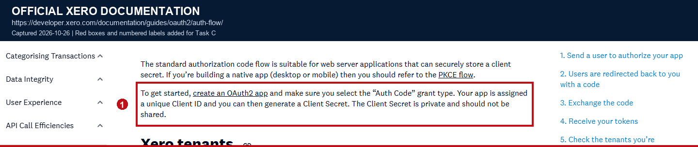

*Screenshot evidence: (1) the standard authorisation-code flow requires the server to keep the client secret safe; (2) the documentation explicitly states that the Client Secret is private and must not be shared.*

Screenshot original: [View original](screenshots/c6-auth-client-secret.png)

Official source: [Xero OAuth 2.0 Authorization Code Flow - Refreshing access and refresh tokens](https://developer.xero.com/documentation/guides/oauth2/auth-flow/)

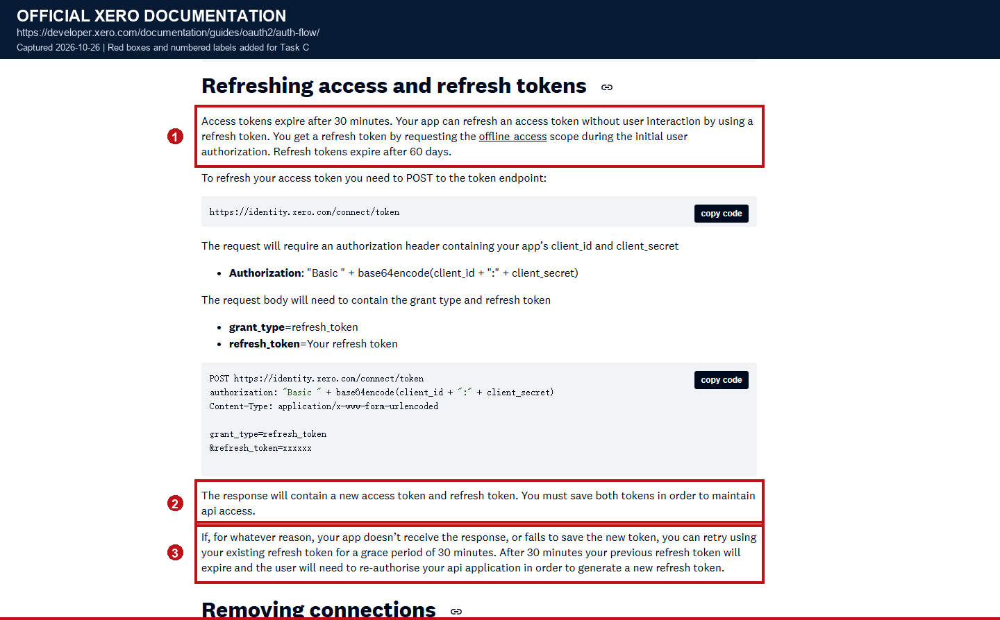

*Screenshot evidence: (1) access tokens usually last 30 minutes and refresh tokens usually 60 days; (2) the refresh response contains a new access token and a new refresh token, and both must be saved; (3) the old refresh token has a 30-minute grace period.*

Screenshot original: [View original](screenshots/c6-refresh-token-grace.png)

Official source: [Xero OAuth 2.0 FAQ - refresh-token expiry and replacement](https://developer.xero.com/faq/oauth2/)

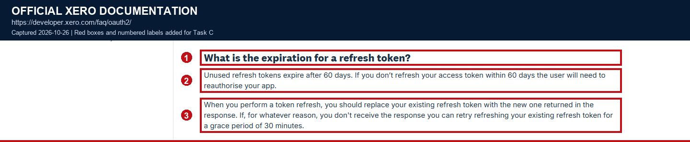

*Screenshot evidence: (1) an unused refresh token expires after 60 days; (2) the refresh response's new refresh token should replace the existing one; (3) if the response is lost, the existing refresh token can be retried for 30 minutes.*

Screenshot original: [View original](screenshots/c6-oauth-faq-refresh-rotation.png)

Official source: [Xero Security standard for API consumers](https://developer.xero.com/partner/security-standard-for-xero-api-consumers)

- The standard requires encryption of stored refresh tokens and encryption at rest for repositories containing sensitive commercial or personal information.
- It requires TLS 1.2 or higher, secure application-server configuration, vulnerability management, security monitoring, and immutable audit logging. It states that audit logs should generally be retained for at least one year.

**Why this step**

- Token rotation is a state transition, not a single HTTP call; a non-atomic write or stale worker can strand a tenant with a refresh token that can no longer be used.
- Client Secret rotation is an application-wide availability event. Whether old and new values can coexist is a provider behaviour that must be tested, not inferred.
- Strong encryption is ineffective if a secret is also written to a log, an overly broad KMS role, or a frontend bundle.

Official source: [Xero OAuth 2.0 Troubleshooting - TLS errors](https://developer.xero.com/documentation/guides/oauth2/troubleshooting/)


*Screenshot evidence: (1) all OAuth 2.0 API traffic requires TLS 1.2 or higher; (2) older versions may receive an HTML `Access Denied` response.*

Screenshot original: [View original](screenshots/c2-tls-errors.png)

### C6 redacted logging and metrics pseudocode

- Logs are constructed only from allowed fields, rather than logging the whole object and then trying to remove sensitive values.
- `normalise_endpoint` must remove query strings, credentials, and raw IDs before logging; the `endpoint` field in logs is normalised as well.
- Metric labels use only low-cardinality fields such as environment, endpoint, status, and a controlled error class. Tenant and resource IDs go only into logs and traces.
- A missing HTTP status represents a transport failure and is labelled `network_error`; unknown error codes are mapped to a bounded `other` value.

```python
ALLOWED_LOG_FIELDS = {
    "trace_id", "job_id", "run_id", "tenant_record_id", "tenant_id",
    "invoice_intent_id", "endpoint", "method", "attempt",
    "status", "latency_ms", "error_code", "correlation_id",
}

FORBIDDEN_FIELDS = {
    "access_token", "refresh_token", "authorization",
    "client_secret", "code", "bank_account", "invoice_payload",
}

def write_api_observation(event):
    safe_fields = {
        key: value
        for key, value in event.fields.items()
        if key in ALLOWED_LOG_FIELDS and key not in FORBIDDEN_FIELDS
    }
    if "endpoint" in safe_fields:
        safe_fields["endpoint"] = normalise_endpoint(safe_fields["endpoint"])

    logger.structured("xero_api_call", **safe_fields)

    status_class = (
        f"{event.status // 100}xx"
        if event.status is not None
        else "network_error"
    )
    error_code = normalise_error_code(event.error_code)

    metrics.increment(
        "xero_api_calls_total",
        labels={
            "environment": event.environment,
            "endpoint": normalise_endpoint(event.endpoint),
            "status_class": status_class,
            "error_code": error_code,
        },
    )
    if event.cursor_age_seconds is not None:
        metrics.gauge(
            "xero_cursor_age_seconds",
            event.cursor_age_seconds,
            labels={"environment": event.environment},
        )

    if event.error_code in {
        "invalid_grant",
        "AuthenticationUnsuccessful",
        "RETRY_BUDGET_EXHAUSTED",
        "MANUAL_RECONCILIATION_REQUIRED",
    }:
        alerts.raise_incident(
            code=event.error_code,
            correlation_id=event.correlation_id,
            safe_context=safe_fields,
        )
```

### C6 acceptance checklist

- Every log can be correlated to the internal trace, job ID, tenant, and Xero `X-Correlation-Id`.
- Logs contain no tokens, authorisation codes, client secrets, full authorisation headers, or full financial data.
- Metrics cover authentication, rate limiting, latency, retries, cursor age, sync lag, conflicts, and the reconciliation backlog.
- Alerts cover refresh failures, disappearing tenants, persistent 429s, exhausted retries, stale cursors, and a long-lived `UNKNOWN`.
- Access tokens are cached with a TTL derived from `expires_in`; refresh tokens are encrypted at rest with a versioned KMS key and are never stored in plaintext.
- Refresh-token updates use a per-tenant lease and an atomic optimistic-lock update; concurrent or stale workers cannot overwrite a newer token version.
- A failed database commit leaves the old tokens intact, and the cache is updated only after the commit succeeds.
- A lost optimistic lock returns `RETRY_WITH_LATEST`; a stale `invalid_grant` cannot force re-authorisation when a newer token version exists.
- A cache failure after a successful database commit invalidates the cache and still returns `REFRESHED`.
- KMS outage and decryption failure fail closed, alert, and never fall back to plaintext.
- Client Secret rotation records only versioned references, requires explicit overlap confirmation, uses a rotation lock, and rolls back on a failed health check.
- Metric labels contain no tenant/resource IDs, and an absent HTTP status is classified as `network_error`.
- `invalid_grant`, user disconnection, revoked access, and tenant disappearance stop workers and trigger auditable credential cleanup.
- Every access is checked against the three boundaries of environment, internal tenant, and authorised user; an externally supplied `tenantId` is never trusted directly.

## Screenshot index

### C1 Connection Verification

- [c1-token-expiry.png](screenshots/c1-token-expiry.png)
- [c1-connections-endpoint.png](screenshots/c1-connections-endpoint.png)
- [c1-tenant-header-refresh.png](screenshots/c1-tenant-header-refresh.png)

### C2 Failure Diagnosis

- [c2-response-codes.png](screenshots/c2-response-codes.png)
- [c2-invalid-grant.png](screenshots/c2-invalid-grant.png)
- [c2-tenant-auth-errors.png](screenshots/c2-tenant-auth-errors.png)
- [c2-invoice-scopes.png](screenshots/c2-invoice-scopes.png)
- [c2-tls-errors.png](screenshots/c2-tls-errors.png)

### C3 Incremental Synchronisation

- [c3-modified-since-limitations.png](screenshots/c3-modified-since-limitations.png)
- [c3-pagination.png](screenshots/c3-pagination.png)
- [c3-invoice-ordering.png](screenshots/c3-invoice-ordering.png)
- [c3-invoice-identifiers.png](screenshots/c3-invoice-identifiers.png)

### C4 Rate Limits

- [c4-rate-limits.png](screenshots/c4-rate-limits.png)
- [c4-429-retry-after.png](screenshots/c4-429-retry-after.png)
- [c4-retryable-response-codes.png](screenshots/c4-retryable-response-codes.png)
- [c4-idempotency-rate-limit.png](screenshots/c4-idempotency-rate-limit.png)

### C5 Data Integrity

- [c5-idempotency-key.png](screenshots/c5-idempotency-key.png)
- [c5-idempotency-cache-conflicts.png](screenshots/c5-idempotency-cache-conflicts.png)
- [c5-idempotency-errors.png](screenshots/c5-idempotency-errors.png)
- [c5-idempotency-state.png](screenshots/c5-idempotency-state.png)
- [c5-create-response-check.png](screenshots/c5-create-response-check.png)

### C6 Observability and Security

- [c6-correlation-id.png](screenshots/c6-correlation-id.png)
- [c6-auth-client-secret.png](screenshots/c6-auth-client-secret.png)
- [c6-refresh-token-grace.png](screenshots/c6-refresh-token-grace.png)
- [c6-oauth-faq-refresh-rotation.png](screenshots/c6-oauth-faq-refresh-rotation.png)

## Official references

- OAuth 2.0 Authorization Code Flow: [https://developer.xero.com/documentation/guides/oauth2/auth-flow/](https://developer.xero.com/documentation/guides/oauth2/auth-flow/)
- Tenants and connections: [https://developer.xero.com/documentation/guides/oauth2/tenants/](https://developer.xero.com/documentation/guides/oauth2/tenants/)
- OAuth scopes: [https://developer.xero.com/documentation/guides/oauth2/scopes/](https://developer.xero.com/documentation/guides/oauth2/scopes/)
- OAuth limits: [https://developer.xero.com/documentation/guides/oauth2/limits/](https://developer.xero.com/documentation/guides/oauth2/limits/)
- OAuth troubleshooting: [https://developer.xero.com/documentation/guides/oauth2/troubleshooting/](https://developer.xero.com/documentation/guides/oauth2/troubleshooting/)
- Invoices API: [https://developer.xero.com/documentation/api/accounting/invoices/](https://developer.xero.com/documentation/api/accounting/invoices/)
- HTTP requests and responses, modified-since, and pagination: [https://developer.xero.com/documentation/api/accounting/requests-and-responses](https://developer.xero.com/documentation/api/accounting/requests-and-responses)
- HTTP response codes: [https://developer.xero.com/documentation/api/accounting/responsecodes](https://developer.xero.com/documentation/api/accounting/responsecodes)
- Idempotent requests: [https://developer.xero.com/documentation/guides/idempotent-requests/idempotency/](https://developer.xero.com/documentation/guides/idempotent-requests/idempotency/)
- OAuth 2.0 FAQ: [https://developer.xero.com/faq/oauth2/](https://developer.xero.com/faq/oauth2/)
- Security standard for API consumers: [https://developer.xero.com/partner/security-standard-for-xero-api-consumers](https://developer.xero.com/partner/security-standard-for-xero-api-consumers)
